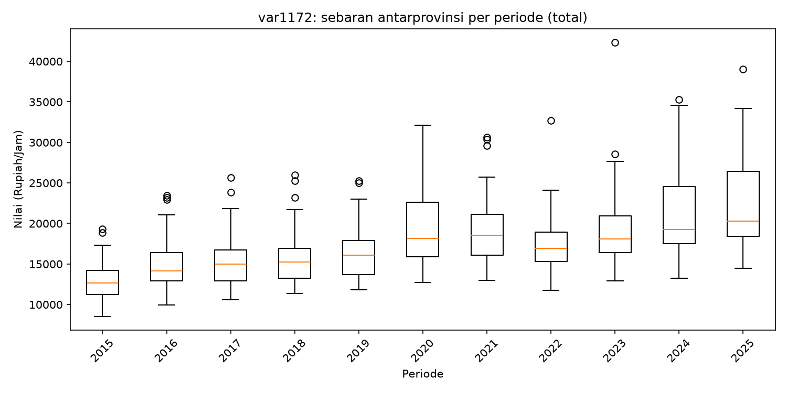
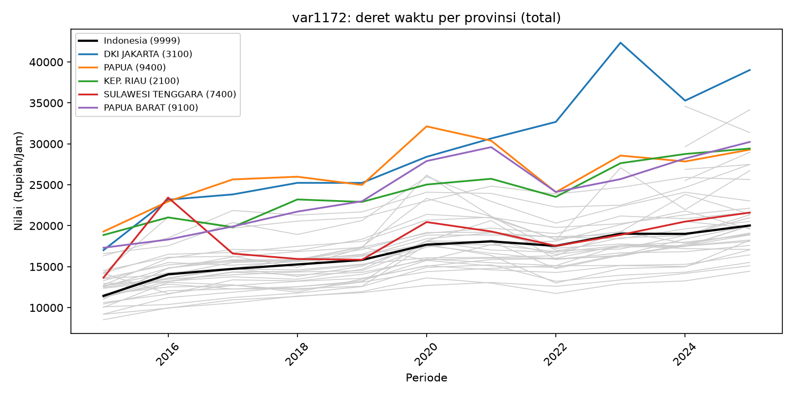
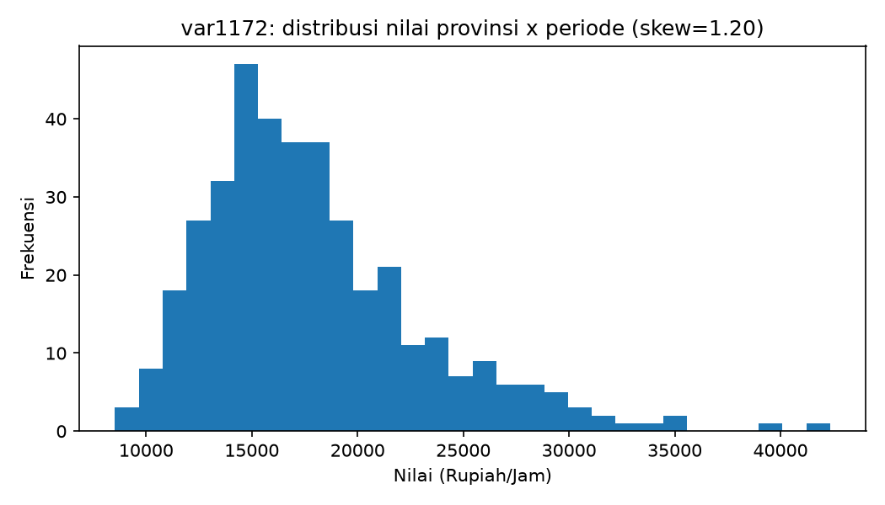
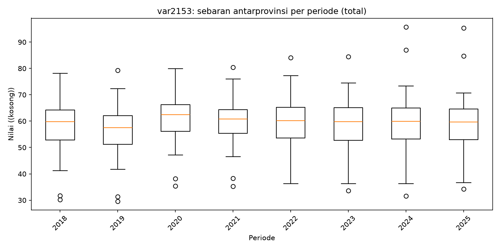
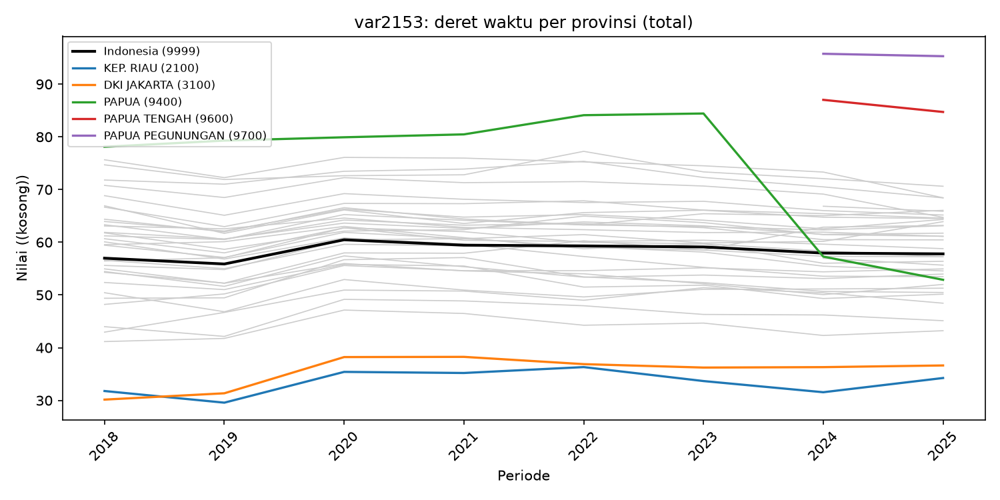
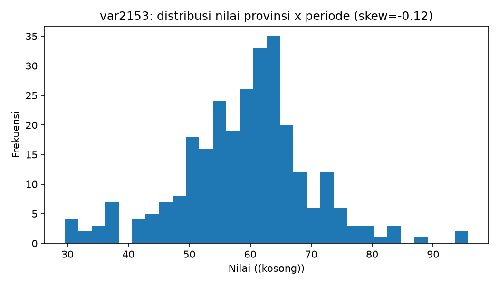

# Profil Tahap 2: var1172 dan var2153

Dihasilkan oleh `src/profil/profil_tahap2.py`. Tujuan: menemukan, bukan memperbaiki. Tidak ada nilai yang diubah. Semua angka di bawah dapat dihasilkan ulang dengan skrip itu.

Ambang: |z| >= 3.0 (lintas provinsi per periode dan perubahan antar-periode per provinsi); pagar IQR 1.5xIQR; calon patahan bila >= 80% provinsi bergerak searah > 15%.

## Ringkasan per seri

| seri_kode   | judul                                             | satuan     |   n_baris |   periode_min |   periode_max | jenis_periode   |   n_provinsi_unik | ada_baris_indonesia   |   n_rincian |   kelengkapan_grid_total |     min |        q1 |   median |      mean |        q3 |      max |       sd |   skew |   nilai_nonpositif |   nilai_di_atas_100 |
|:------------|:--------------------------------------------------|:-----------|----------:|--------------:|--------------:|:----------------|------------------:|:----------------------|------------:|-------------------------:|--------:|----------:|---------:|----------:|----------:|---------:|---------:|-------:|-------------------:|--------------------:|
| var1172     | Upah rata-rata per jam (BPS, SDG 8.5.1)           | Rupiah/Jam |       393 |          2015 |          2025 | Tahun           |                38 | True                  |           1 |                    0.914 | 8525    | 14326.2   | 17009    | 17915.1   | 20494.8   | 42354    | 5200.47  |  1.202 |                  0 |                 382 |
| var2153     | Proporsi lapangan kerja informal (BPS, SDG 8.3.1) | (kosong)   |       288 |          2018 |          2025 | Tahun           |                38 | True                  |           1 |                    0.921 |   29.57 |    53.418 |    60.33 |    59.216 |    64.762 |    95.76 |   10.688 | -0.115 |                  0 |                   0 |

## Uji silang CSV vs JSON

| seri_kode   |   baris_silver |   baris_kanonik |   kunci_di_kedua_format |   kunci_hanya_csv |   kunci_hanya_json |   kunci_beda_nilai |
|:------------|---------------:|----------------:|------------------------:|------------------:|-------------------:|-------------------:|
| var1172     |            786 |             393 |                     393 |                 0 |                  0 |                  0 |
| var2153     |            576 |             288 |                     288 |                 0 |                  0 |                  0 |

## Jumlah provinsi per periode

| seri_kode   |   periode |   n_provinsi |
|:------------|----------:|-------------:|
| var1172     |      2015 |           34 |
| var1172     |      2016 |           34 |
| var1172     |      2017 |           34 |
| var1172     |      2018 |           34 |
| var1172     |      2019 |           34 |
| var1172     |      2020 |           34 |
| var1172     |      2021 |           34 |
| var1172     |      2022 |           34 |
| var1172     |      2023 |           34 |
| var1172     |      2024 |           38 |
| var1172     |      2025 |           38 |
| var2153     |      2018 |           34 |
| var2153     |      2019 |           34 |
| var2153     |      2020 |           34 |
| var2153     |      2021 |           34 |
| var2153     |      2022 |           34 |
| var2153     |      2023 |           34 |
| var2153     |      2024 |           38 |
| var2153     |      2025 |           38 |

## Calon anomali (ditandai, tidak diubah)

| seri_kode   | jenis                   |   wilayah_kode | nama_wilayah      |   periode |    nilai | alasan                                                      |
|:------------|:------------------------|---------------:|:------------------|----------:|---------:|:------------------------------------------------------------|
| var1172     | ekstrem_lintas_provinsi |           2100 | KEP. RIAU         |      2015 | 18863    | di luar pagar IQR [6765; 1.867e+04]                         |
| var1172     | ekstrem_lintas_provinsi |           9400 | PAPUA             |      2015 | 19290    | di luar pagar IQR [6765; 1.867e+04]                         |
| var1172     | ekstrem_lintas_provinsi |           3100 | DKI JAKARTA       |      2016 | 23181    | di luar pagar IQR [7671; 2.168e+04]                         |
| var1172     | ekstrem_lintas_provinsi |           7400 | SULAWESI TENGGARA |      2016 | 23444    | di luar pagar IQR [7671; 2.168e+04]                         |
| var1172     | ekstrem_lintas_provinsi |           9400 | PAPUA             |      2016 | 22961    | di luar pagar IQR [7671; 2.168e+04]                         |
| var1172     | ekstrem_lintas_provinsi |           3100 | DKI JAKARTA       |      2017 | 23826    | di luar pagar IQR [7287; 2.235e+04]                         |
| var1172     | ekstrem_lintas_provinsi |           9400 | PAPUA             |      2017 | 25657    | di luar pagar IQR [7287; 2.235e+04]                         |
| var1172     | ekstrem_lintas_provinsi |           2100 | KEP. RIAU         |      2018 | 23212    | di luar pagar IQR [7672; 2.248e+04]                         |
| var1172     | ekstrem_lintas_provinsi |           3100 | DKI JAKARTA       |      2018 | 25238    | di luar pagar IQR [7672; 2.248e+04]                         |
| var1172     | ekstrem_lintas_provinsi |           9400 | PAPUA             |      2018 | 25987    | di luar pagar IQR [7672; 2.248e+04]                         |
| var1172     | ekstrem_lintas_provinsi |           3100 | DKI JAKARTA       |      2019 | 25236    | di luar pagar IQR [7365; 2.426e+04]                         |
| var1172     | ekstrem_lintas_provinsi |           9400 | PAPUA             |      2019 | 24984    | di luar pagar IQR [7365; 2.426e+04]                         |
| var1172     | ekstrem_lintas_provinsi |           3100 | DKI JAKARTA       |      2021 | 30662    | di luar pagar IQR [8498; 2.867e+04]                         |
| var1172     | ekstrem_lintas_provinsi |           9100 | PAPUA BARAT       |      2021 | 29600    | di luar pagar IQR [8498; 2.867e+04]                         |
| var1172     | ekstrem_lintas_provinsi |           9400 | PAPUA             |      2021 | 30382    | di luar pagar IQR [8498; 2.867e+04]                         |
| var1172     | ekstrem_lintas_provinsi |           3100 | DKI JAKARTA       |      2022 | 32685    | z=3.59 lintas provinsi; di luar pagar IQR [9884; 2.438e+04] |
| var1172     | ekstrem_lintas_provinsi |           3100 | DKI JAKARTA       |      2023 | 42354    | z=4.07 lintas provinsi; di luar pagar IQR [9594; 2.778e+04] |
| var1172     | ekstrem_lintas_provinsi |           9400 | PAPUA             |      2023 | 28570    | di luar pagar IQR [9594; 2.778e+04]                         |
| var1172     | ekstrem_lintas_provinsi |           3100 | DKI JAKARTA       |      2024 | 35281    | di luar pagar IQR [6974; 3.506e+04]                         |
| var1172     | ekstrem_lintas_provinsi |           3100 | DKI JAKARTA       |      2025 | 39018.9  | di luar pagar IQR [6338; 3.854e+04]                         |
| var2153     | ekstrem_lintas_provinsi |           2100 | KEP. RIAU         |      2018 |    31.78 | di luar pagar IQR [35.74; 81.38]                            |
| var2153     | ekstrem_lintas_provinsi |           3100 | DKI JAKARTA       |      2018 |    30.15 | di luar pagar IQR [35.74; 81.38]                            |
| var2153     | ekstrem_lintas_provinsi |           2100 | KEP. RIAU         |      2019 |    29.57 | di luar pagar IQR [34.8; 78.47]                             |
| var2153     | ekstrem_lintas_provinsi |           3100 | DKI JAKARTA       |      2019 |    31.35 | di luar pagar IQR [34.8; 78.47]                             |
| var2153     | ekstrem_lintas_provinsi |           9400 | PAPUA             |      2019 |    79.29 | di luar pagar IQR [34.8; 78.47]                             |
| var2153     | ekstrem_lintas_provinsi |           2100 | KEP. RIAU         |      2020 |    35.41 | di luar pagar IQR [41.01; 81.38]                            |
| var2153     | ekstrem_lintas_provinsi |           3100 | DKI JAKARTA       |      2020 |    38.22 | di luar pagar IQR [41.01; 81.38]                            |
| var2153     | ekstrem_lintas_provinsi |           2100 | KEP. RIAU         |      2021 |    35.2  | di luar pagar IQR [41.97; 77.78]                            |
| var2153     | ekstrem_lintas_provinsi |           3100 | DKI JAKARTA       |      2021 |    38.26 | di luar pagar IQR [41.97; 77.78]                            |
| var2153     | ekstrem_lintas_provinsi |           9400 | PAPUA             |      2021 |    80.47 | di luar pagar IQR [41.97; 77.78]                            |
| var2153     | ekstrem_lintas_provinsi |           9400 | PAPUA             |      2022 |    84.11 | di luar pagar IQR [36.16; 82.6]                             |
| var2153     | ekstrem_lintas_provinsi |           2100 | KEP. RIAU         |      2023 |    33.67 | di luar pagar IQR [34.1; 83.72]                             |
| var2153     | ekstrem_lintas_provinsi |           9400 | PAPUA             |      2023 |    84.43 | di luar pagar IQR [34.1; 83.72]                             |
| var2153     | ekstrem_lintas_provinsi |           2100 | KEP. RIAU         |      2024 |    31.55 | di luar pagar IQR [35.62; 82.58]                            |
| var2153     | ekstrem_lintas_provinsi |           9600 | PAPUA TENGAH      |      2024 |    87.02 | di luar pagar IQR [35.62; 82.58]                            |
| var2153     | ekstrem_lintas_provinsi |           9700 | PAPUA PEGUNUNGAN  |      2024 |    95.76 | z=3.09 lintas provinsi; di luar pagar IQR [35.62; 82.58]    |
| var2153     | ekstrem_lintas_provinsi |           2100 | KEP. RIAU         |      2025 |    34.25 | di luar pagar IQR [35.74; 81.84]                            |
| var2153     | ekstrem_lintas_provinsi |           9600 | PAPUA TENGAH      |      2025 |    84.72 | di luar pagar IQR [35.74; 81.84]                            |
| var2153     | ekstrem_lintas_provinsi |           9700 | PAPUA PEGUNUNGAN  |      2025 |    95.3  | z=3.26 lintas provinsi; di luar pagar IQR [35.74; 81.84]    |

## Grafik

- 
- 
- 
- 
- 
- 

## Hal yang perlu diputuskan di log (bukan dikerjakan di tahap ini)

- Satuan `var2153`: bandingkan besaran nilai dengan kolom `satuan` di atas.
- Apakah `var1172` nominal atau riil, dan apakah ada patahan serentak (lihat `calon_patahan_seri`).
- Provinsi baru hasil pemekaran (Kaltara, empat provinsi Papua): lihat tabel jumlah provinsi per periode.